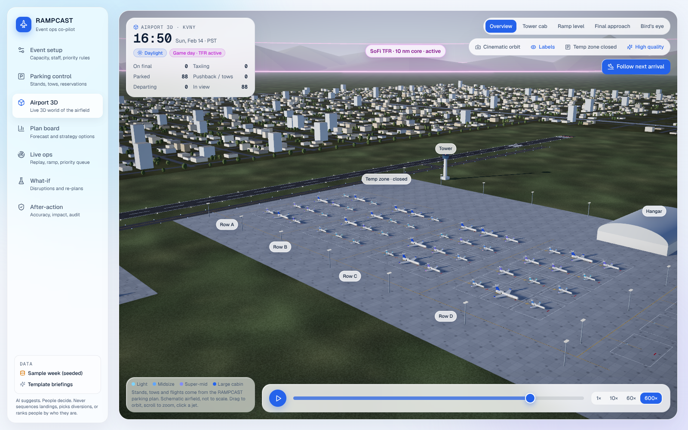
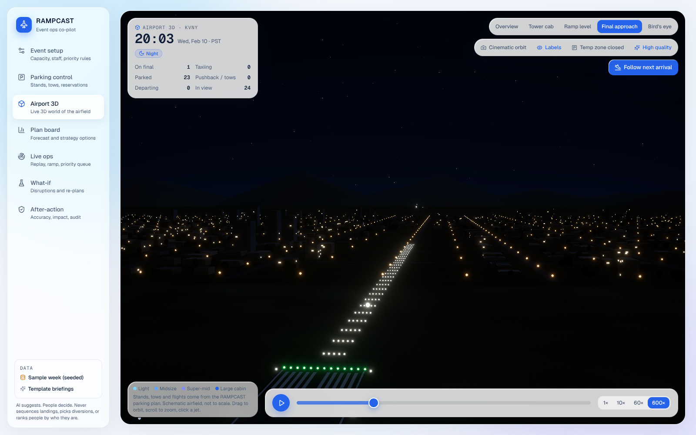
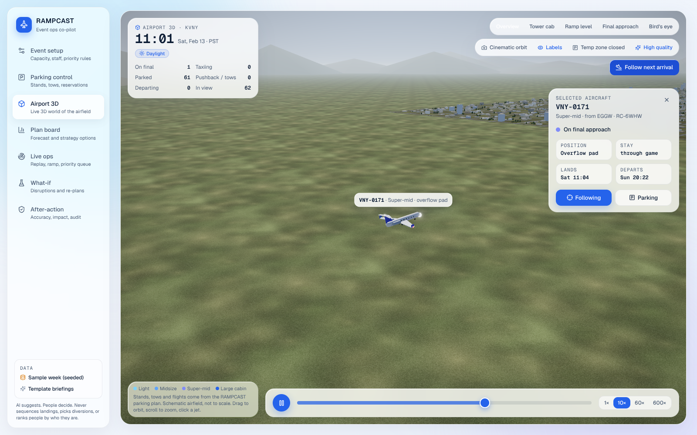
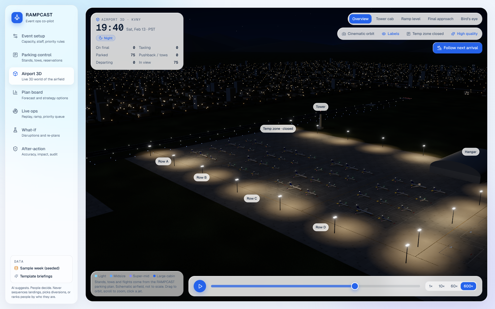

# RAMPCAST

**SpartHill Hacks 2026 · Track 01 "The Intelligent FBO" · Focus: Parking**

RAMPCAST is an AI ramp-capacity planner for a fictional FBO, *Sepulveda Jet Center*, at Van Nuys Airport (KVNY) during Super Bowl LXI week (Sun Feb 14 2027, SoFi Stadium). It forecasts parking demand, shows which hours the ramp overflows under low, medium and high demand, and drafts a plan (reservation caps, overflow partners, stand arrangement, fuel and crews) that a human FBO manager approves. The stretch goal runs the same engine on the LA28 Olympics opening week.

**The AI, in one line:** a probabilistic demand forecast (P10–P90, 120-run Monte Carlo of the ramp) plus an optimizer (departure-aware stand assignment with local search, three overflow strategies scored on capacity, risk, CO₂ and staff), with every sentence in the briefings generated from the engine's facts. It runs fully offline: no API keys, no external model.

Visual blueprint: [`docs/rampcast-blueprint.html`](docs/rampcast-blueprint.html)
End-to-end research (takeoff → landing → ramp → car → hotel, decision rights, 22 edge cases, runway-closure scenario): [`docs/gate-to-hotel.html`](docs/gate-to-hotel.html)
Team contracts (file and API shapes, assumptions): [`contracts/`](contracts/)

## Run it

```bash
make setup      # Python venv + npm install (one time)
make dev        # API on :8000 and app on http://localhost:5173
make test       # server tests + app typecheck
```

No keys or accounts are needed: briefings, what-if explanations and answers to the manager's questions come from the built-in writer, which only words the engine's facts and cites each number. (Optional: `RAMPCAST_USE_CLAUDE=1` plus an Anthropic key lets Claude word the same facts.) Open a specific replay moment with `http://localhost:5173/?t=2027-02-12T10:00:00-08:00#live`.

**Data.** Parking control, Live ops, Airport 3D and After-action replay the Super Bowl LVI week (Feb 2022, same stadium) shifted +1,827 days to 2027. `make data` (Role 1 pipeline, `data/scripts/build_processed.py`) builds every file in `data/processed/`:
- With a real OpenSky pull on disk (`make fetch`, needs internet and a free OpenSky account), it uses those flights and the app labels them "Real 2022 replay (OpenSky)".
- Without one, it rebuilds the week across 11 LA-basin airports from the published counts (501 business-jet arrivals on Friday 11 Feb, 548 departures on Monday 14 Feb, about 2× normal traffic), with real feeder airports, local arrival hours and each jet's departure paired to its arrival. The app labels it "2022 week, from published counts". This repo ships that rebuild, because OpenSky is unreachable from the build environment.

**Plug-in modules.** `server/rampcast_server/adapters.py` swaps in team modules as soon as they exist: `rampcast.forecast.api.get_forecast/get_occupancy` and `rampcast.engine.api.get_strategies`. Each returns the shapes in `contracts/README.md`. Until then, the built-in reference engine answers every route.

**Decision engine (Role 3).** `rampcast/engine/` holds strategies and the stand plan (both OR-Tools CP-SAT), the need-based priority queue, alerts, alternates (runway lengths from OurAirports, fetched by `data/scripts/fetch_ourairports.py`), what-if, the Claude layer (`claude-sonnet-5-5`) and the append-only audit log. The stand plan treats "nobody boxed in" as a hard rule and solves one day at a time so the same input always gives the same plan; set `RAMPCAST_STANDS_MODE=portfolio` for a whole-week parallel solve that is a little better but not bit-for-bit repeatable. Tests: one file per module in `server/tests/`.

## Product tour (demo path)

| Screen | What it shows | Demo beat |
|---|---|---|
| **Parking control** (home) | Schematic FBO apron at VNY (48 stacked stands, drop-and-go hot spots, temporary taxiway zone, hangar, car staging) with jets drawn to wingspan; RAMPCAST arrangement vs whiteboard; tow sheet; stand allocation chart for the week; reservation board; click a jet to move it, with validation and tow impact | Toggle to "Whiteboard" (546 tows) and back (148, −73%); open the temp zone (82 tows); move a jet and approve |
| **Airport 3D** | Live 3D world of the field driven by the same parking plan: every flight flies the approach, lands, taxis to its assigned stand, gets towed, pushes back and departs on the replay clock. Sun, sky and floodlights follow the time of day; the Valley street grid, freeway traffic, approach-light rabbit and the game-day SoFi TFR curtain set the scene | Press "Follow next arrival"; switch Tower cab / Ramp level / Final approach; scrub to Sunday 16:50 to see the TFR go live, then to night |
| Event setup | Event facts, FBO capacity, staff, fuel trucks, need-based priority weights, the data-certainty ladder | "The manager sets the rules; the AI never uses name, status or price" |
| Plan board | Ordinary week vs Super Bowl week (P10–P90), hour-by-day ramp heatmap, strategies A/B/C with approvers, briefing | Switch Low/Medium/High; approve Strategy B |
| Live ops | Replay clock, inbound map with an LA-basin inset and the SoFi TFR rings, stand map with boxed-in flags, alerts, ground-handling priority queue | Press play at 600x; open the #1 queue item and approve the car |
| What-if | Runway closure, demand +20%, Friday arrival bank 3 h late, early customs close; before/after KPIs including staffing; option cards for operators' dispatchers | Run "Friday bank 3 h late" (peak movements 11 → 16/h, techs 12 → 16); show that the pilot decides |
| After-action | Forecast error vs the naive rule, interval coverage, hours over capacity avoided, CO2 avoided, the audit trail | Close on "what the AI never decides" |
| **LA28 stretch** | Same engine on the LA28 Olympics opening week (Tue 11 – Mon 17 Jul 2028, ceremony Fri 14 Jul): ordinary July vs Olympic week, ramp occupancy vs the Super Bowl, side-by-side comparison, five adapted recommendations with approvers, stated assumptions | "The Super Bowl spikes and clears; the Olympics fill the ramp and stay: 107 jets still parked at week end vs 13" |

### Airport 3D

| Game day, TFR active | Night, final approach |
|---|---|
|  |  |
|  |  |

Built with three.js through React Three Fiber, all procedural (no model or texture files): instanced jets sized per class, merged airfield geometry, canvas-painted concrete, asphalt and grass, an art-directed sky dome, N8AO ambient occlusion and bloom. The 3D code loads only when the screen opens. "Fast mode" turns off AO and lowers resolution for laptops on battery.

## Why this angle

1. **LA already hosted this game.** Super Bowl LVI was played at SoFi in Feb 2022. That week is a real, labelled analog, so we can train on data before it, forecast it blind, and report real error.
2. **Parking is the binding constraint.** In 2022 the FAA ran an FBO **parking reservation program** (Feb 6–14) at LAX, HHR, VNY, BUR, LGB, SNA, ONT, SBD and SMO.
3. **The TFR pushes traffic to VNY.** The 2022 game-day TFR had a 10 nm core and a 30 nm ring. HHR (1.9 nm), LAX (3.5), SMO (6.7) and TOA (9.0) sit inside the core. VNY is at 17.1 nm.
4. **Overflow is an emissions problem.** Jets that can't park fly empty repositioning legs. Planning the ramp well cuts them, and the savings are measured in gallons and tonnes of CO₂.

## Real reference numbers

| Event | Figure | Source |
|---|---|---|
| LVI, LA 2022 | 1,400+ bizav flights in the days before; 501 arrivals on the Friday peak; 548 departures the Monday after | FlightAware / WingX via BJT |
| LX, Bay Area 2026 | 1,000+ arrivals over 4 days (~2× normal); ~600 Monday departures (~3×); OAK 32%, SFO 22%, SJC 22% | WingX via GlobalAir |
| LVIII, Las Vegas 2024 | 882 private planes | WingX via AP |

## Data

```bash
python data/scripts/fetch_opensky.py --preset analog     # LVI week, 11 LA-basin airports
python data/scripts/fetch_opensky.py --preset baseline   # ordinary Jan–Feb windows
python data/scripts/fetch_faa_registry.py                # icao24 -> model -> size class
```

- OpenSky REST API: free account; set `OPENSKY_CLIENT_ID` and `OPENSKY_CLIENT_SECRET` for higher limits. Tail IDs are hashed on save.
- FAA Releasable Aircraft Registry: used for size class, parking footprint and fuel uplift.
- FAA OPSNET daily counts are used to calibrate ADS-B coverage. Iowa Mesonet ASOS supplies weather.
- Aircraft in the FAA LADD program are excluded (privacy).

## Models

- **M1 Baseline:** seasonal forecast of ordinary-week arrivals, with P10–P90.
- **M2 Event uplift:** a multiplier curve by day relative to the game, built from real analogs (LVI–LX).
- **M3 Ramp simulator:** Monte Carlo of hourly occupancy, giving P(over capacity) per hour.
- **M4 Plan optimizer:** reservation caps, drop-and-go quota, nearest-partner overflow, fuel and crews.

## Human in command

The AI never decides whether a specific aircraft may land, park or depart, and never picks which customer gets the last spot. Movement authority stays with ATC and the pilot in command. Spot allocation stays with the FBO manager. Every plan line goes through an approve, edit or reject step with an audit log.
