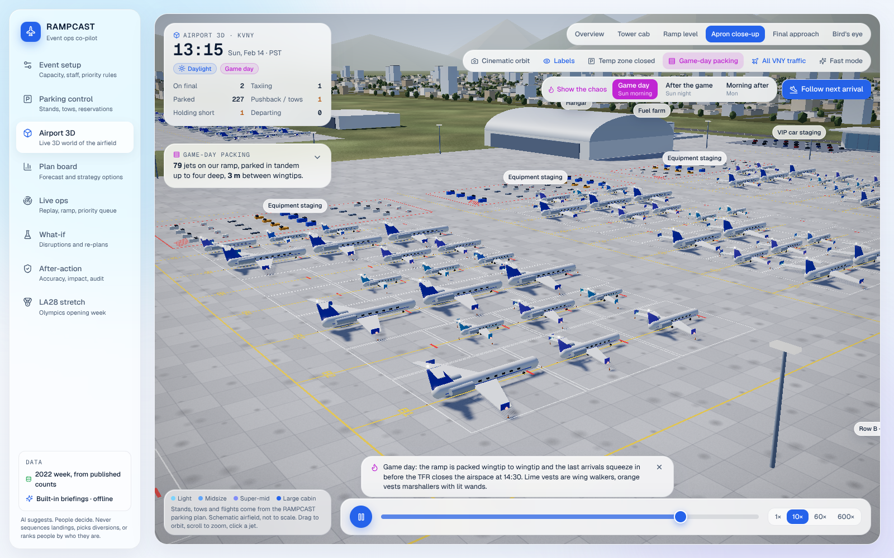
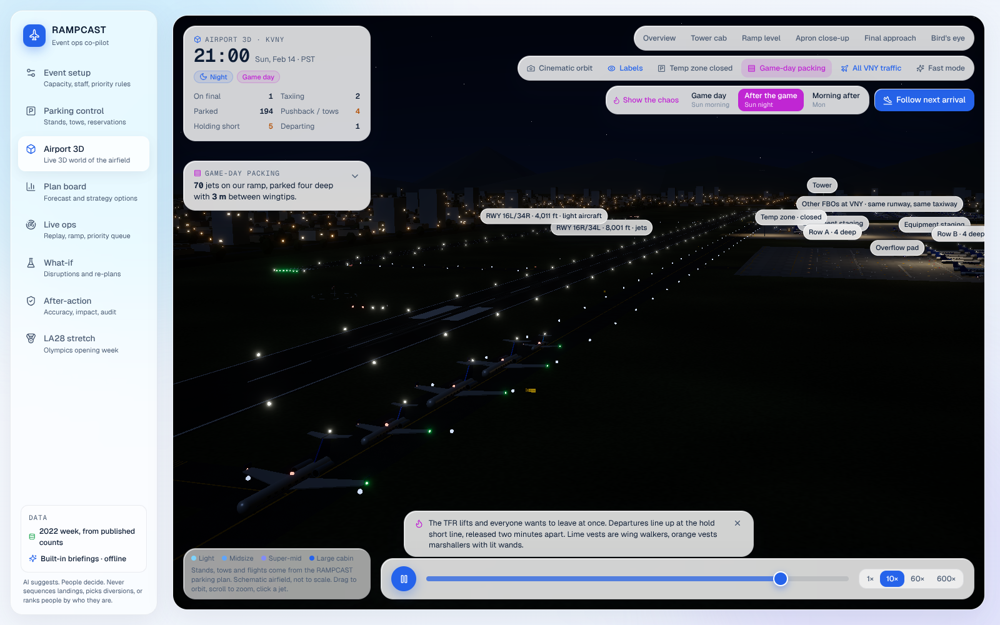
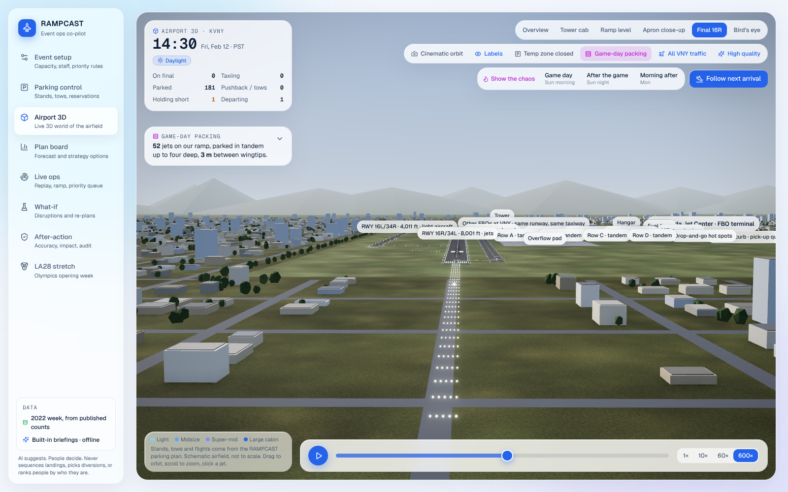
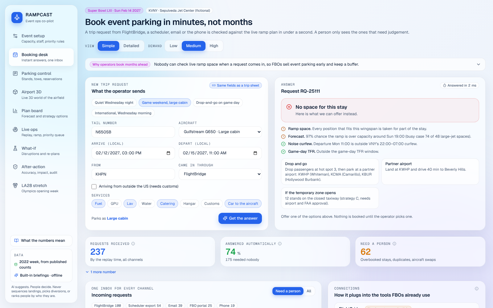
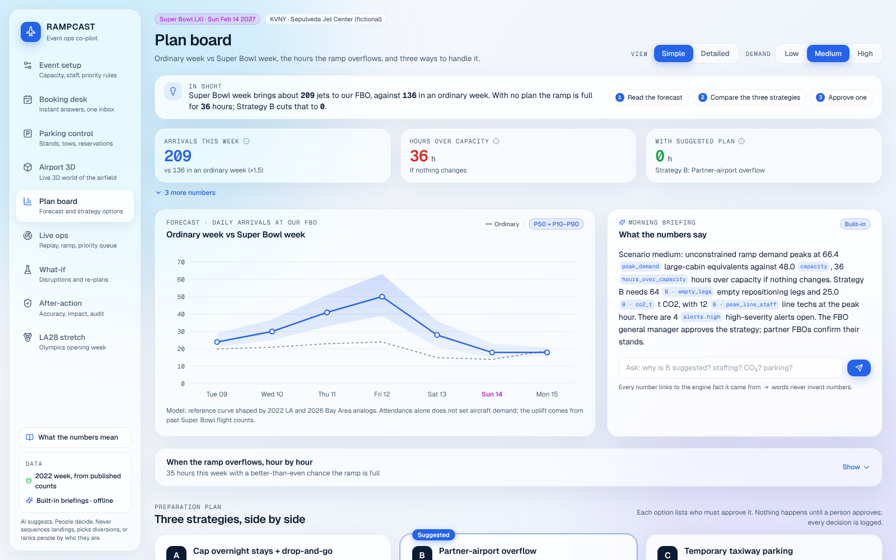

# RAMPCAST

**SpartHill Hacks 2026 · Track 01 "The Intelligent FBO" · Focus: Parking**

RAMPCAST is an AI ramp-capacity planner for a fictional FBO, *Sepulveda Jet Center*, at Van Nuys Airport (KVNY) during Super Bowl LXI week (Sun Feb 14 2027, SoFi Stadium). It forecasts parking demand, shows which hours the ramp overflows under low, medium and high demand, and drafts a plan (reservation caps, overflow partners, stand arrangement, fuel and crews) that a human FBO manager approves. The stretch goal runs the same engine on the LA28 Olympics opening week.

It also answers a parking request the moment it arrives (from FlightBridge, a scheduler, email or the phone) instead of weeks later, and shows game-day ramp operations in 3D the way a pilot would see them: jets packed wingtip to wingtip, wing walkers on every tow, and a departure queue at the hold short line.

**The AI, in one line:** an analog-uplift demand forecast (P10–P90) and a 5,000-week Monte Carlo of the ramp, two stand planners (an adaptive heuristic and an OR-Tools CP-SAT solver) measured against a whiteboard on the same week, a CP-SAT strategy optimizer for overflow partners, rules, a need-based priority queue and an instant booking desk, all brought together on the **AI co-pilot** screen: what needs doing now, why, which models said so, and who approves. Every sentence in the briefings is generated from the engine's facts. It runs fully offline: no API keys, no external model.

Visual blueprint: [`docs/rampcast-blueprint.html`](docs/rampcast-blueprint.html)
End-to-end research (takeoff → landing → ramp → car → hotel, decision rights, 22 edge cases, runway-closure scenario): [`docs/gate-to-hotel.html`](docs/gate-to-hotel.html)
Team contracts (file and API shapes, assumptions): [`contracts/`](contracts/)

## Run it

```bash
make setup      # Python venv + npm install (one time)
make dev        # API on :8000 and app on http://localhost:5173
make test       # server tests + app typecheck
```

No keys or accounts are needed: briefings, what-if explanations and answers to the manager's questions come from the built-in writer, which only words the engine's facts and cites each number.

- **Local LLM**: Run completely private and offline with your own local models (e.g. Ollama, LM Studio, vLLM, llama.cpp). Start Ollama (`ollama run llama3.2`) and launch with `RAMPCAST_USE_LOCAL_LLM=1 make dev`. Customize endpoint with `LOCAL_LLM_URL` (default: `http://127.0.0.1:11434/v1/chat/completions`) and model with `LOCAL_LLM_MODEL` (auto-detected by default).
- **Claude (optional)**: `RAMPCAST_USE_CLAUDE=1` plus an Anthropic key lets Claude word the same facts.

Open a specific replay moment with `http://localhost:5173/?t=2027-02-12T10:00:00-08:00#live`.

**Data.** Parking control, Live ops, Airport 3D and After-action replay the Super Bowl LVI week (Feb 2022, same stadium) shifted +1,827 days to 2027. `make data` (Role 1 pipeline, `data/scripts/build_processed.py`) builds every file in `data/processed/`:
- With a real OpenSky pull on disk (`make fetch`, needs internet and a free OpenSky account), it uses those flights and the app labels them "Real 2022 replay (OpenSky)".
- Without one, it rebuilds the week across 11 LA-basin airports from the published counts (501 business-jet arrivals on Friday 11 Feb, 548 departures on Monday 14 Feb, about 2× normal traffic), with real feeder airports, local arrival hours and each jet's departure paired to its arrival. The app labels it "2022 week, from published counts". This repo ships that rebuild, because OpenSky is unreachable from the build environment.

**Plug-in modules.** `server/rampcast_server/adapters.py` swaps in team modules as soon as they exist: `rampcast.forecast.api.get_forecast/get_occupancy` and `rampcast.engine.api.get_strategies`. Each returns the shapes in `contracts/README.md`. Until then, the built-in reference engine answers every route.

**Decision engine (Role 3).** `rampcast/engine/` holds strategies and the stand plan (both OR-Tools CP-SAT), the need-based priority queue, alerts, alternates (runway lengths from OurAirports, fetched by `data/scripts/fetch_ourairports.py`), what-if, the Claude layer (`claude-sonnet-5-5`) and the append-only audit log. The stand plan treats "nobody boxed in" as a hard rule and solves one day at a time so the same input always gives the same plan; set `RAMPCAST_STANDS_MODE=portfolio` for a whole-week parallel solve that is a little better but not bit-for-bit repeatable. Tests: one file per module in `server/tests/`.

## Product tour (demo path)

| Screen | What it shows | Demo beat |
|---|---|---|
| **AI co-pilot** (first screen) | Every model asked what needs doing at the replay time, ranked now / today / this week: tows in the next 3 hours, customs and curfew alerts (grouped by action), who to serve first at the curb, hours the ramp is likely full, bookings that need a person, the strategy to approve, staff short at the peak, whether to open the temp zone. Each suggestion lists its numbers, the models behind it and the role that approves. Below: a pipeline of the 11 models, an algorithm arena (whiteboard vs adaptive vs CP-SAT on the same week), a model card per model (question, method, inputs labelled published / reconstructed / assumption / live, outputs, "never use it to", code path, live evidence) and the forecast's blind test on real FAA data | Move the replay clock to Friday 13:00 and read the "Now" list; click a model chip to jump to its card; switch the arena to "Temp zone open" and watch CP-SAT win |
| **Booking desk** | Accepting a booking puts the jet in the plan on the quoted slot (held for its stay, cancellable) and "Watch it land in 3D" follows it in. Instant answer to a trip request from the live parking plan and forecast: a position, the price, a 15-minute hold, customs, curfew and TFR checks, or alternatives (shift the time, drop-and-go, partner airport, temp zone) when full. One inbox for FlightBridge, scheduler exports, email, phone and the portal: small ETA moves re-plan automatically; overbooked stays, duplicates, aircraft swaps and customs problems go to a person. Connections to FlightBridge, schedulers, FBO systems and FlightAware are labelled with exactly what works today | Try "Game weekend, large cabin" (full: here are the options), then "Quiet Wednesday night" (confirmed in milliseconds); open "Why operators book months ahead" |
| **Parking control** | Two layouts from one engine: game-day tandem packing (columns three or four deep, 3 m between wingtips, hot spots, overflow pad, temp zone) and the 48 marked stands of an ordinary week. RAMPCAST arrangement vs the exact solver (CP-SAT) vs whiteboard; tow sheet; stand allocation chart; reservation board; click a jet to move it, with validation and tow impact. Plans use the departure time owners give, so tows count what really happened | Game-day tandem: whiteboard 958 tows, RAMPCAST 48 (−95%). Marked stands: 546 vs 194 (−64%), 136 with the temp zone |
| **Airport 3D** | Live 3D world of the field driven by the same parking plan. Game-day packing: tandem rows with 3 m between wingtips, jets in front towed aside so a deeper jet can leave, wing walkers, marshallers with lit wands, cones, staged equipment and the curb queue. All of VNY's traffic shares runway 16R: arrivals 90 s apart, departures 2 min apart, and a departure queue at the hold short line. Pilot details: 16R/34L and 16L/34R with designators, FAA-style signs, distance-remaining boards, windsock, non-movement boundary; the sun and the SoFi bearing follow the real runway heading. Pilot's view from the cockpit (heading, ground speed, altitude), simulated Tower, Ground and Ramp radio with ATIS, seven paint schemes. Same plan and tows as Parking control | Press "Show the chaos": Game day, After the game (night queue), Morning after; click a jet, then "Pilot's view"; switch to Final 16R |
| Event setup | Event facts, FBO capacity, staff, fuel trucks, need-based priority weights, the data-certainty ladder | "The manager sets the rules; the AI never uses name, status or price" |
| Plan board | Ordinary week vs Super Bowl week (P10–P90), hour-by-day ramp heatmap, strategies A/B/C with approvers, briefing | Switch Low/Medium/High; approve Strategy B |
| Live ops | Replay clock, inbound map with an LA-basin inset and the SoFi TFR rings, stand map with boxed-in flags, alerts, ground-handling priority queue | Press play at 600x; open the #1 queue item and approve the car |
| What-if | Runway closure, demand +20%, Friday arrival bank 3 h late, early customs close; before/after KPIs including staffing; option cards for operators' dispatchers | Run "Friday bank 3 h late" (peak movements 11 → 16/h, techs 12 → 16); show that the pilot decides |
| After-action | The blind test on real FAA counts (the low-to-high range held on 86% of real days; the medium line alone no better than naive), the replay gap labelled as a consistency check rather than accuracy, hours over capacity avoided, CO2 avoided, the audit trail | Close on "what the AI never decides" |
| **LA28 stretch** | Same engine on the LA28 Olympics opening week (Tue 11 – Mon 17 Jul 2028, ceremony Fri 14 Jul): ordinary July vs Olympic week, ramp occupancy vs the Super Bowl, side-by-side comparison, five adapted recommendations with approvers, stated assumptions | "The Super Bowl spikes and clears; the Olympics fill the ramp and stay: 107 jets still parked at week end vs 13" |

### Airport 3D

| Game day: tandem packing, 3 m wingtip clearance | After the game: departure queue at the hold short line |
|---|---|
|  |  |
|  |  |

| Game day, TFR active | Night, final approach |
|---|---|
|  |  |
|  |  |

Built with three.js through React Three Fiber, all procedural (no model or texture files): instanced jets sized per class, merged airfield geometry, canvas-painted concrete, asphalt and grass, an art-directed sky dome, N8AO ambient occlusion and bloom. The 3D code loads only when the screen opens. "Fast mode" turns off AO and lowers resolution for laptops on battery.

### Built for a first-time user

Every screen opens in the **Simple** view: one "In short" sentence with the next steps, the three numbers that matter, and an (i) on each number that says what it means and where it comes from. Secondary panels fold to one line; **Detailed** shows everything. "What the numbers mean" in the sidebar is a searchable glossary with sources.



### What changed after the judges' review

| Feedback | What we built |
|---|---|
| On the event day FBOs park jets very close together, and it is chaos | Game-day packing from the server engine, shared by every screen (275 visits placed, no overlaps, 48 tows vs 958 on a whiteboard), ramp crews, the whole field's traffic on one runway, radio, pilot's view, and three "Show the chaos" moments |
| Private jet parking must be booked months ahead; FlightBridge and the other tools don't connect | The booking desk: the missing check of live ramp space, answered in milliseconds, with one inbox and honest connection status |
| Too many numbers and too much text for a first-time user | The simple view, explanations on every key number, folding panels and the glossary; a phone layout |

## Why this angle

1. **LA already hosted this game.** Super Bowl LVI was played at SoFi in Feb 2022. That week is a real, labelled analog, so we can train on data before it, forecast it blind, and report real error.
2. **Parking is the binding constraint.** In 2022 the FAA ran an FBO **parking reservation program** (Feb 6–14) at LAX, HHR, VNY, BUR, LGB, SNA, ONT, SBD and SMO.
3. **The TFR pushes traffic to VNY.** The 2022 game-day TFR had a 10 nm core and a 30 nm ring. HHR (1.9 nm), LAX (3.5), SMO (6.7) and TOA (9.0) sit inside the core. VNY is at 17.1 nm.
4. **Overflow is an emissions problem.** Jets that can't park fly empty repositioning legs. Planning the ramp well cuts them, and the savings are measured in gallons and tonnes of CO₂.

## Real reference numbers

| Event | Figure | Source |
|---|---|---|
| LVI, LA 2022 | 1,400+ bizav flights in the days before; 501 arrivals on the Friday peak; 548 departures the Monday after | FlightAware / WingX via BJT |
| LX, Bay Area 2026 | 1,000+ arrivals over 4 days (~2× normal); ~600 Monday departures (~3×); OAK 32%, SFO 22%, SJC 22% | WingX via GlobalAir |
| LVIII, Las Vegas 2024 | 882 private planes | WingX via AP |

## Data

```bash
python data/scripts/fetch_opensky.py --preset analog     # LVI week, 11 LA-basin airports
python data/scripts/fetch_opensky.py --preset baseline   # ordinary Jan–Feb windows
python data/scripts/fetch_faa_registry.py                # icao24 -> model -> size class
```

- OpenSky REST API: free account; set `OPENSKY_CLIENT_ID` and `OPENSKY_CLIENT_SECRET` for higher limits. Tail IDs are hashed on save.
- FAA Releasable Aircraft Registry: used for size class, parking footprint and fuel uplift.
- FAA OPSNET daily counts are used to calibrate ADS-B coverage. Iowa Mesonet ASOS supplies weather.
- Aircraft in the FAA LADD program are excluded (privacy).

## Models

Every model has a card on the AI co-pilot screen (`GET /ai/models`) with its method, inputs and their sources, limits and live evidence.

| Model | Method | Code | Owner |
|---|---|---|---|
| Arrivals forecast | Weekday baseline × event uplift scaled to published WingX ratios (1.5× / 1.75× / 2.0×), negative-binomial spread | `rampcast/forecast/` ([model card](rampcast/forecast/MODEL_CARD.md)) | Role 2 |
| Ramp Monte Carlo | 5,000 simulated weeks; hourly occupancy in large-cabin equivalents; P(over capacity) | `rampcast/forecast/ramp_sim.py` | Role 2 |
| Strategy optimizer | Three plans; OR-Tools CP-SAT sends overflow to partner FBOs within their spaces; CO₂, staff, risk | `rampcast/engine/strategies.py` | Role 3 |
| Stand planner, adaptive (default) | Each arrival placed from who is parked now and their stated departures, then whole-week local search | `server/rampcast_server/parking.py` | core |
| Stand planner, exact | OR-Tools CP-SAT, day by day; "nobody boxed in" as a hard rule with a one-sigma drift margin; jets re-parked on arrival if their slot is still taken | `rampcast/engine/stands.py` | Role 3 + core |
| Departure drift | Stated departure = actual + Gaussian error (3 h for stays over 20 h, 1 h over 3 h); planners see only the stated time | `parking.py` (`_as_told`) | core |
| Booking desk | Best free slot for the whole stay, customs, curfew, ramp risk; confirms by itself when every check passes | `server/rampcast_server/bookings.py` | core |
| Priority queue, alerts, alternates, what-if, explanations | Need-based weights; rule checks; incremental CP-SAT re-plan after a disruption; text built only from cited facts | `rampcast/engine/` | Role 3 |

**Measured on the replayed week** (tows counted from when jets really left; `GET /ai/benchmark`): game-day tandem, whiteboard 958 tows, adaptive 48, CP-SAT 78, nobody turned away; with the temp zone open, adaptive 40, CP-SAT 28. A plan that is perfect on paper breaks when owners leave late, so the adaptive planner is the default and the co-pilot suggests CP-SAT where it measures better.

**Validation, on real data.** Role 2 pulled FAA TFMSC daily business-jet counts (public, checksummed: `data/external/faa_tfmsc/`): KVNY every day of Jan–Mar 2019–2026 and the airports around seven Super Bowl host regions. In a blind leave-one-event-out test (each Super Bowl forecast only from the others), the low-to-high range held on 86% of 49 real days (target 80%), but the medium line alone was no better than "same as an ordinary week" (41% vs 41% daily error), and host-city surges over-forecast Van Nuys, a secondary airport for a SoFi game (97% vs 18% in 2022). A version fitted on Van Nuys's own 2022 surge gives the same week total and a lower peak (61 vs 68 large-cabin equivalents; 30 vs 34 hours likely over capacity), so the overflow conclusion holds either way. Every screen therefore shows the range, not one number. Details: `rampcast/forecast/MODEL_CARD.md`, `reports/backtest_summary.csv`. The replayed 2022 week is rebuilt from published counts, so the app does not report daily accuracy on it.

**Data labels.** Every row in `data/processed/` says how it was made: `reconstructed_2022` (or `opensky_2022_shifted` for a real pull), `_anchor` on the two days whose basin totals are published, or `synthetic` for generated history and other host cities. Nothing generated is labelled published.

## Human in command

The AI never decides whether a specific aircraft may land, park or depart, and never picks which customer gets the last spot. Movement authority stays with ATC and the pilot in command. Spot allocation stays with the FBO manager. Every plan line goes through an approve, edit or reject step with an audit log.
